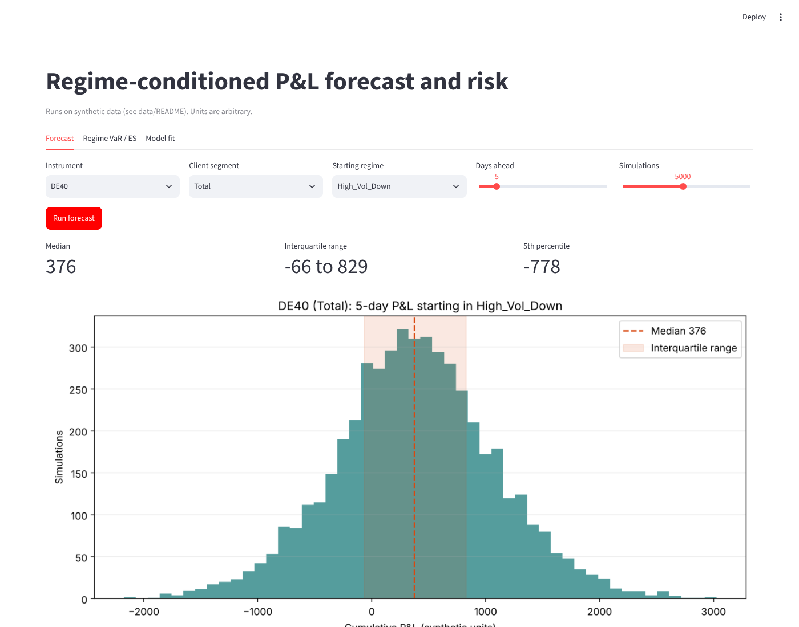
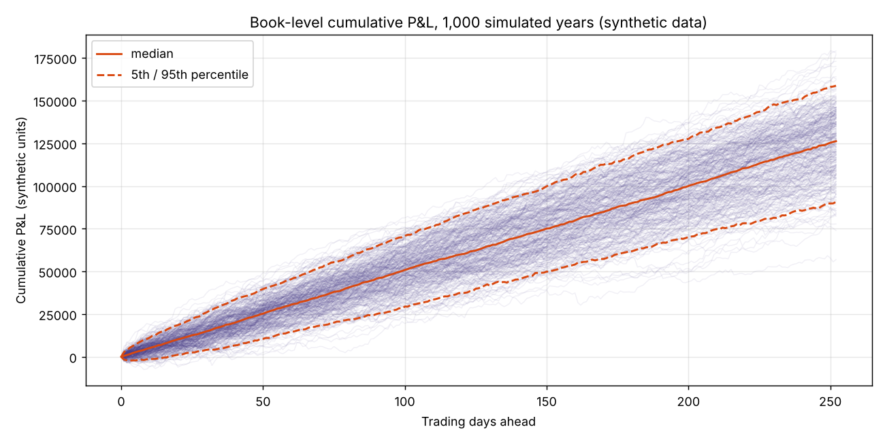
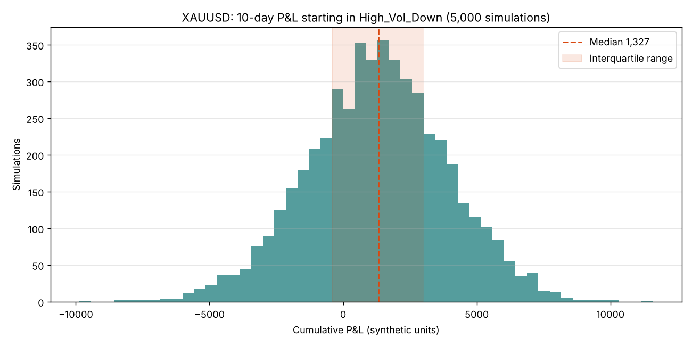
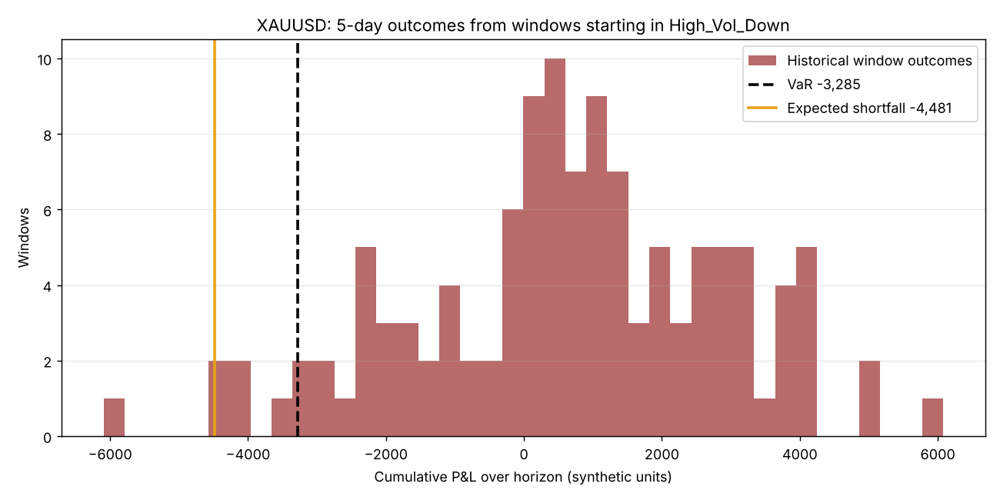

# Regime P&L forecast tool

A Monte Carlo and historical VaR tool for a broker that takes the other side of client trades. I built it during my internship at Valutrades, a CFD broker, in summer 2025. The strategy team and the CFO used it to size the capital buffer held against client flow and to judge when to hedge.

The original ran on the firm's internal daily P&L and volume data, which is confidential and is **not** in this repository. This version runs on a synthetic dataset with the same structure (see [Data](#data)). The numbers in the charts below are not real.



## The question

A broker's daily P&L on an instrument depends on how much clients trade and on which way the market moves against their net position. Both behave differently in a quiet market and in a volatile one. So the useful question is "what does P&L look like **from the kind of day we are in now**?"

## Method

**1. Regimes.** Every day on every instrument gets one of four labels: intraday range above or below that instrument's median, crossed with whether the day closed up or down (`High_Vol_Down`, `Low_Vol_Up`, and so on).

**2. One model per instrument, client segment and regime.** A linear regression of daily P&L on lots traded, the day's return and its intraday range, fitted only on days in that regime. The residuals are kept.

**3. Monte Carlo.** For each simulated day, the regime is set (the starting regime on day 1, then drawn from the instrument's historical regime frequencies). The drivers (lots, return, range) are resampled from real days in that regime, passed through that regime's model, and a residual from the same regime is added. Summing over days gives a distribution of cumulative P&L: median, interquartile range, and tail percentiles.

**4. Regime-conditional historical VaR and expected shortfall.** For a chosen horizon, take every historical window of consecutive trading days that **started** in the chosen regime and sum P&L over it. VaR is the empirical quantile of those outcomes, and expected shortfall is the average of the outcomes beyond it. There is no distributional assumption and no extrapolation. In practice this was the number the team trusted most.

| Simulated paths for the whole book | 10-day forecast from a volatile down day |
|---|---|
|  |  |



## Limitations, and what I would change

- **The regression was never formally validated.** At the firm I checked the fit by eye and moved on. On the synthetic data the median in-sample R² is about 0.06 (see the *Model fit* tab), so most of the simulated spread comes from resampled residuals, not from the fitted drivers. The missing driver is the clients' net position: P&L depends on *position × move*, and the model only sees the move. Adding net exposure as a feature is the first thing I would do.
- **Regimes have no memory.** After day 1, each day's regime is drawn independently, but volatile days cluster. An empirical regime transition matrix (a Markov chain) would fix this.
- **Instruments are simulated independently.** The book-level forecast ignores correlation between instruments, such as gold and USDJPY on a risk-off day. Resampling one common historical date across all instruments would keep it.
- **Regime labels use full-sample medians.** That is fine for describing history, but a live classifier needs a trailing median.
- **Small samples.** Each regime has roughly 100 days per instrument, and the VaR windows overlap. A 99% VaR from about 100 overlapping windows rests on one or two observations, so I'd treat it as indicative.

## Changes from the version used at the firm

- Refactored into a library (`forecast.py`) and a separate Streamlit front end (`app.py`).
- Vectorised the Monte Carlo, which used to sample one pandas row at a time.
- **Fixed the VaR windows.** The original summed P&L over N consecutive *regime days*, which were not necessarily consecutive trading days. It now uses true N-trading-day windows that begin in the regime.
- Client regions replaced by anonymous segments A and B, and all data replaced with synthetic data.

## Run it

```bash
pip install -r requirements.txt
python scripts/make_synthetic_data.py   # optional: the CSV is already in data/
streamlit run app.py
```

`python forecast.py` prints the regime counts, the per-regime model fit and a one-year book simulation without the front end.

## Data

`data/synthetic_flow.csv` is generated by `scripts/make_synthetic_data.py` (fixed seed). Prices follow a geometric Brownian motion with some volatility clustering. Lots rise on high-range days. P&L is spread income per lot, minus the client segment's net position (an AR(1) process) times the price move, plus Student-t noise. None of the parameters come from real data.

## Files

```
app.py                         Streamlit front end
forecast.py                    regimes, models, Monte Carlo, VaR/ES, plots
scripts/make_synthetic_data.py synthetic dataset generator
data/synthetic_flow.csv        synthetic data (2024-01 to 2025-07, 5 instruments)
figures/                       charts used in this README
```
